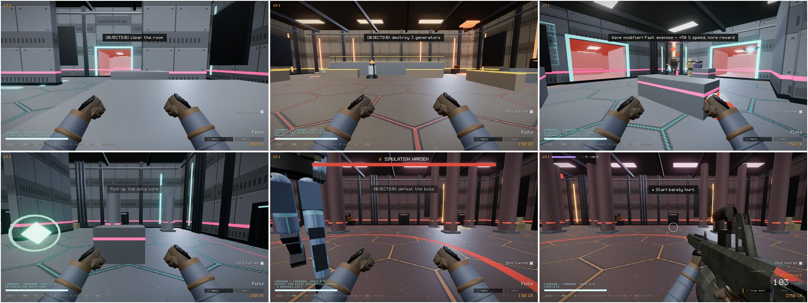
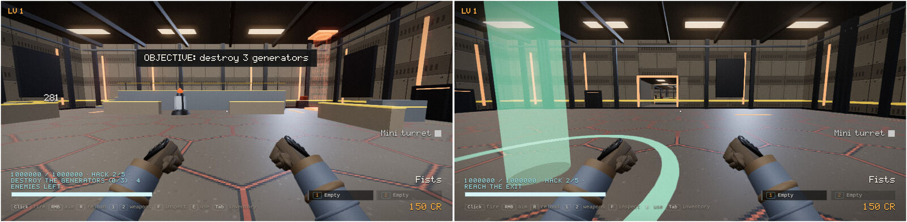

# Tarea 3 — Campaña «Hack», fases a y b (`opus/campana`, sale de `opus/integracion`)

La campaña sustituye al hack por sectores (decisión del usuario). Lo hecho hasta aquí son los datos y el motor;
la entrada desde el hall (fase c) y el acto completo con el jefe nuevo (fase d) vienen después. **Parada pedida por
el brief tras la fase b.**

## Fase a — datos y guardado
- **`src/data/campaign.json`**: los 5 niveles son solo datos, sin código por nivel. Cada uno lleva tema, salas (3–6),
  dificultad, modificador, cadena de objetivos, opcionales y recompensa.

  | Nivel | Tema | Cadena | Mod. | Botín |
  |---|---|---|---|---|
  | 1 Acceso | centro de datos | despejar → hackear 20 s → salir | — | rara |
  | 2 Fundición | fundición | despejar → destruir 3 generadores → aguantar 2 oleadas → salir | — | rara |
  | 3 El laberinto | laberinto | eliminar al comandante → recuperar el núcleo → sacarlo por la salida | rápidos | épica |
  | 4 Biolab | biolab | hackear 30 s → destruir 4 generadores → eliminar al mech → salir | duros | épica |
  | 5 El núcleo | arena | despejar → hackear 25 s → jefe | — | **legendaria garantizada** |

- **`src/game/campaign.ts`** (puro):
  - `validateLevels` comprueba la tabla.
  - `planLevel` reparte los objetivos por las salas según la semilla: rejugable, con el jefe siempre al final y el
    cofre oculto en una sala al azar.
  - Desbloqueo en orden, estrellas por los opcionales (cofre oculto, tiempo, poco daño), créditos ×2 la primera vez
    y +25 % por cada estrella nueva.
  - La legendaria del jefe final solo está garantizada la primera vez.
  - `migrateCampaign` hace la migración suave de partidas antiguas. Se guarda en `campaign` del guardado.
- **Arreglo de paso** (ya en `opus/integracion`): el guardado perdía nivel, súperes, armaduras y retículas al
  cargar. Ver el traspaso.

## Fase b — motor (sobre la incursión)
- **`src/game/campaignrun.ts`** (puro): lleva la cadena de una partida y solo avanza el objetivo en curso. También
  cuenta el tiempo, el daño recibido y el cofre, y da el texto del HUD.
- **`src/game/raid.ts` → `startCampaign`**: mapa del tema del nivel. Cada objetivo va en su sala; las demás son de
  solo combate. Los 8 tipos funcionan:

  | Objetivo | Cómo se juega |
  |---|---|
  | despejar | matar todo lo de la sala |
  | hackear | terminal con anillo en el suelo; dentro el anillo se pone verde y suma, fuera se pierde despacio; refuerzos mientras dura |
  | destruir | generadores (`pylon`, núcleo naranja que late; no atacan), con refuerzos |
  | eliminar | el objetivo lleva un rombo rojo visible a través de paredes; al caer, la sala se abre |
  | recuperar | al despejar aparece el núcleo verde; se coge al acercarse |
  | aguantar | N oleadas con respiro entre ellas |
  | jefe | la sala del jefe de siempre, con sus fases |
  | salir | baliza verde que solo aparece cuando toca |

- **`main.ts`**:
  - `startCampaign(id)` (expuesto en `__game`).
  - Al ganar: recompensas, avisos de estrellas y de nivel desbloqueado.
  - Al caer cuenta el intento.
  - HUD «HACK n/5 · objetivo (progreso)».
  - Resumen con nivel y estrellas.
  - Textos ES/EN.

## Verificado
- **Tests:** `tests/campaign.test.ts` (7) y `tests/campaignrun.test.ts` (6), más raid, hack, save e i18n en verde.
  `tsc` limpio.
- **Juego real con `tools/capture/campana.mjs`:** juega solo cada nivel (teletransporte, enemigos eliminados por
  código, se queda en el terminal…). **Los 5 niveles se completan de principio a fin** sin errores de consola.
  - Se abren en orden.
  - El 5 entrega la legendaria y marca `finalReward`.
  - Se ganan estrellas de tiempo y de daño.

## Lo que falta o no me convence
- **Fase c:** entrada desde el hall (hoy solo con `__game.startCampaign`); el ordenador sigue lanzando el hack antiguo.
- **Fase d:** el jefe del nivel 5 es el guardián de siempre. El brief pide uno MUY distinto (escala, sala propia,
  fases y patrón aprendible).
- El objetivo va en la línea de vida del HUD (a 960×470 ocupa 3 líneas): mejor un panel propio en la fase c.
- Si el generador de mapas no consigue todas las salas (muy raro), un objetivo podría quedarse sin sala.
- Probado con enemigos eliminados por código y vida infinita: falta el equilibrio jugando de verdad.
