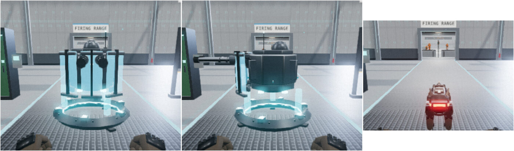

# Tarea 2 — Enemigos nuevos, fase 1 (`opus/enemigos`, sale de `opus/rapier`)

## Qué se ha hecho
Tres enemigos completos de `PLAN_ENEMIGOS.md` con los modelos de Blender del pack 13 (copiados a `assets/enemigos/`):

| | Modelo | Comportamiento | Aviso (telegrafía) | Punto débil |
|---|---|---|---|---|
| **Sabueso** (340 PV, 5,6 m/s) | `enemigo_sabueso.glb` ×1,2 | Jaurías de 2–3. De lejos no va recto: abre hacia un flanco; cada uno muerde por su lado | Se agacha 0,32 s con los ojos encendidos y salta (×4,2 velocidad) | Cabeza (cráneo, visor, mandíbula) |
| **Dron reparador** (240 PV, vuela a 2,4 m) | `enemigo_dron_reparador.glb` ×1,15 | Busca al aliado más herido (30 m), se queda a 5 m y le cura un 5 % cada 0,6 s. Sin heridos, flota a 12 m de ti | Brazo soldador baja, haz y chispas verdes visibles | Cámara delantera |
| **Centinela** (900 PV) | `enemigo_centinela_flotante.glb` ×2,1 | Flota y dispara tres esferas en abanico cada 2,6 s. Gira despacio (0,9 rad/s) y solo dispara cuando ya te encara | Las luces cian y el anillo se aceleran 0,75 s antes del disparo | Escudo frontal (8 % de daño): hay que rodearlo; sensor de arriba |

- **`src/game/enemymodels.ts`**: carga y caché de los GLB (patrón de `gadgetmodel.ts`), precarga al arrancar. Respaldo
  procedural con las mismas piezas y pivotes `mov_*` si el GLB no llega; si llega tarde, se cambia en caliente.
  Las mallas del modelo son las cajas de impacto: la zona sale del nombre de la pieza (`zoneOf`).
- **`src/game/enemyai.ts`** (lógica pura): `flankPoint`, `pickHealTarget` (lo usan también los médicos),
  `turnToward`, `chargeLevel`, `pounceState`.
- **Animación por pivotes**: galope del sabueso (patas delanteras contra traseras, cabeceo), mandíbula al morder,
  patas recogidas al agacharse y estiradas en el salto; rotores y brazo del reparador; anillo y retroceso del cañón
  del centinela. Los ojos/luces se avivan en cada aviso.
- **Oleadas**: sabuesos desde la 1.ª generada, reparador desde la 2.ª, centinela desde la 3.ª (`extraWave`).
  Textos ES/EN (`dummy.hound/repairer/sentinel`).

## Tests
`tests/enemyai.test.ts` (5): flanqueo, fases del salto, elección de curado, giro y carga, zonas por nombre.
Siguen en verde waves, raid, hack, defense, i18n y physics. `npx tsc --noEmit` limpio. Triángulos: 3.424 / 2.628 /
3.476 (presupuesto de robots: 3.500).

## Lo que no me convence (honesto)
- El sabueso, cuando muerde de cerca, asoma por el borde de la pantalla y tapa poco; está bien, pero no tiene
  animación de golpe en el jugador (solo el daño).
- El reparador a 2,4 m queda alto y pequeño desde el suelo; si cuesta verlo, lo bajaría a 1,8 m.
- Médico: ahora mide la distancia en el suelo (antes en 3D): con aliados al mismo nivel es igual.
- Aún no salen en incursiones ni en el Hack (`raidgen`/`hackgen`): lo meto con la campaña (tarea 3).
- El respaldo procedural está probado solo por código (sin captura): con el GLB presente no se ve nunca.

## Siguiente (fase 2)
Rodante artillero, dron bombardero, arañitas en enjambre, mech pesado y asesino; luego invocador y berserker.
