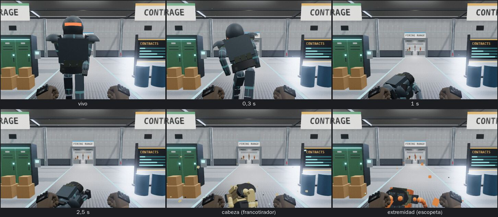
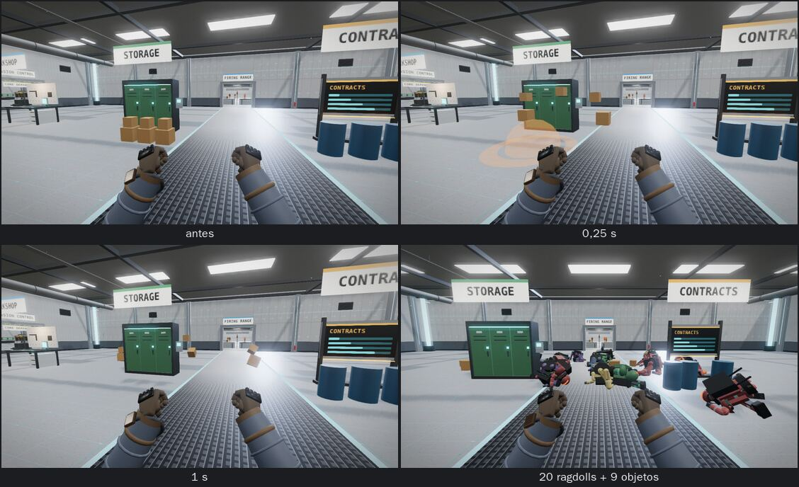

# Tarea 1 — Prototipo de físicas con Rapier (`opus/rapier`)

## Qué se ha hecho
- **`src/game/physics.ts`**: envoltorio de Rapier 0.21 con carga perezosa (`await R.init()`), gravedad −9,8, paso
  fijo de 1/60 s con acumulador (máximo 4 pasos por fotograma, sin entrar en espiral), suelo, cajas estáticas,
  cuerpos caja, esfera, cápsula y cilindro, articulaciones esféricas y bisagras con límites, `applyImpulse`,
  `applyExplosion(centro, radio, fuerza)` con caída lineal, y raycast.
- **Interruptor** `settings.physics` (sin fijar, sigue al modo desarrollador). Desactivado no se importa nada: el
  fragmento de Rapier y la capa de física no se descargan y el juego se comporta igual que antes.
- **Ragdoll** (`src/game/ragdoll.ts`): al morir un humanoide, cabeza, torso, brazos, antebrazos, muslos y espinillas
  pasan a cuerpos rígidos. Cuello, hombros y caderas son esféricas con límite cónico; codos y rodillas, bisagras
  con límites. Las piezas de un mismo muñeco no chocan entre sí, solo con el mundo. Reciben el empuje del disparo
  en el pecho, caen y se funden a los ~4,3 s (el fundido de siempre, retrasado).
- **Desmembramiento en píxeles conservado**: la zona arrancada estalla en cubitos como hoy y queda fuera del
  ragdoll, junto con lo que cuelga de ella (sin brazo no hay antebrazo flotando).
- **Explosiones**: las del arma (`gun.explode`) y las de las granadas empujan objetos y ragdolls, sin tocar
  `gun.ts` ni `grenadefx.ts`. Al activar la física se envuelven sus métodos desde `main.ts`.
- **Objetos de prueba** (solo con física): 6 cajas y 3 barriles junto al pasillo del hall. Reaccionan a los
  balazos (impulso en el punto) y a las explosiones.

## Medidas (este contenedor, CPU, sin GPU)
| | |
|---|---|
| Carga e inicialización de Rapier | 2,5–4,8 s (descarga y compilación del WASM; solo la primera vez) |
| Paso de física con 20 ragdolls + 9 objetos (210 cuerpos) | 1,1–1,9 ms; picos de ~3,4 ms al crearse los 20 a la vez |
| Peso añadido | 1,65 MB gzip (Rapier, fragmento aparte) + 4 KB gzip (capa del juego). El paquete principal no cambia. |

## Tests
`tests/physics.test.ts` (6): acumulador de paso fijo, fuerza radial con caída lineal, límite cónico, exclusión de
zonas arrancadas en el ragdoll, interruptor, y una prueba con Rapier real (la bisagra respeta sus límites y la
explosión empuja hacia fuera). Siguen en verde los tests de oleadas, incursión, hack, defensa y gunplay.
`npx tsc --noEmit` limpio.

## Lo que no me convence (honesto)
- Los muñecos caen **amontonados**, no siempre de espaldas: con piernas largas y un torso de caja, el cuerpo tiende
  a doblarse sobre sí mismo. Mejoraría con un torso en dos piezas (pecho y cadera) y masas por pieza afinadas.
- Las esféricas no tienen límite de giro (twist) y el cono se aplica con un impulso corrector: a veces un hombro
  gira más de lo natural.
- La explosión lanza las cajas muy alto (ya bajada de 9 a 6 m/s).
- **No verificado** en un PC real: el coste por paso se ha medido aquí, en CPU, con render por software.

## Recomendación sobre el motor
Para lo que necesita este juego (ragdolls, empujes y objetos sueltos), **Three.js + Rapier basta**. Con 20
ragdolls el paso cuesta 1–2 ms, el 6–12 % de un fotograma a 60 fps, y lo caro de verdad sigue siendo el dibujo
(tarea 10). Migrar a Godot o Unity daría editor, animación por huesos y herramientas de física maduras, pero
obligaría a rehacer todo: generador de armas, niveles, interfaz, guardado y modelos. Eso son meses. Babylon.js
trae Havok integrado y es lo más cercano, pero tampoco compensa. Propongo seguir con Three.js e integrar Rapier
poco a poco: primero ragdolls y explosiones, luego objetos destructibles. Los 1,6 MB de Rapier se pueden
precargar en el menú.

## Decisiones del usuario
- ¿Física activada por defecto para todos (hoy solo en modo desarrollador)?
- ¿Se quedan las cajas y barriles en el hall o solo para pruebas?
