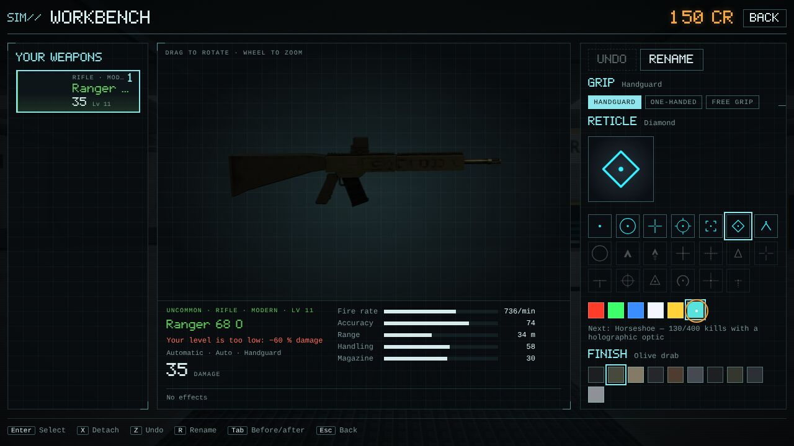
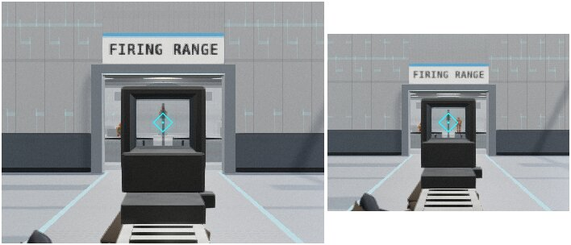

# Tarea 5 — Retículas personalizables y coleccionables (`opus/reticulas`)

## Qué se ha hecho
- **Catálogo de 20 formas** (`src/game/reticles.ts`): las 10 de antes más `dot-ring-ticks`, `t-dot`,
  `circle-cross`, `bracket`, `triangle-dot`, `diamond`, `horseshoe`, `crosshair-dot`, `chevron-dot` y
  `dots-vertical`. Seis colores (rojo, verde, azul, blanco, amarillo, cian) con su brillo a juego.
- **En el arma** (`WeaponSpec.reticle` y `reticleColor`, opcionales): sin elección, la retícula de su óptica en
  rojo, como antes. Si la forma elegida no está desbloqueada, se ve la de la óptica. Las miras de hierro no llevan.
- **Desbloqueo por hitos** (`src/data/reticles.json`, `src/game/reticlecustom.ts`): se empieza con `dot`,
  `ring-dot` y `cross`. El resto se gana con bajas usando una óptica de cada familia (punto rojo, holográfica, de
  aumentos y visor), por ejemplo 50 con punto rojo para `ring`, 100 de aumentos para `chevron-bdc` y 100 con visor
  para `mildot`. Cada desbloqueo muestra un aviso breve. Las bajas en los muñecos de práctica no cuentan.
- **Guardado** con migración suave (`reticles` en la partida): las partidas antiguas empiezan con las tres de
  inicio. Nunca se quita nada ya desbloqueado y se reconocen los hitos ya cumplidos.
- **Selector en el taller** (ES/EN): vista previa grande, formas desbloqueadas primero (las bloqueadas, atenuadas,
  explican qué falta), colores y contador del siguiente hito. Se aplica al instante y se guarda con el arma.

 

## Tests
`tests/reticles.test.ts` (existente, sin cambios: sigue en verde) y `tests/reticlecustom.test.ts` (nuevo:
validez de las 20 formas, colores, hitos, familias, desbloqueo único con aviso, migración y elección
mostrada). `npx tsc --noEmit` limpio. `tests/i18n.test.ts` en verde.

## Para el usuario
- Hitos y orden de desbloqueo a juicio: se cambian en `src/data/reticles.json`.
- El selector solo aparece con óptica montada; las armas con mira de serie del modelo usan su retícula sin elegir.
